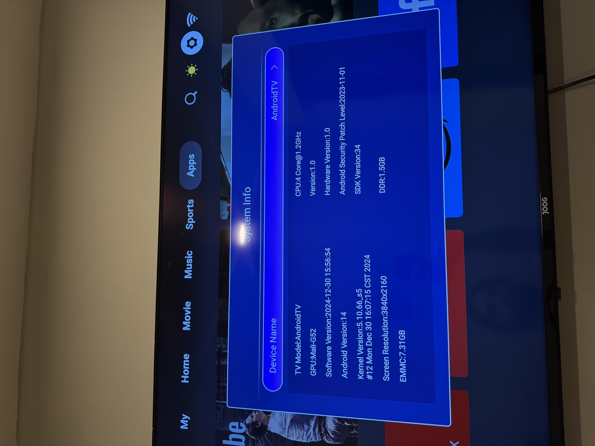
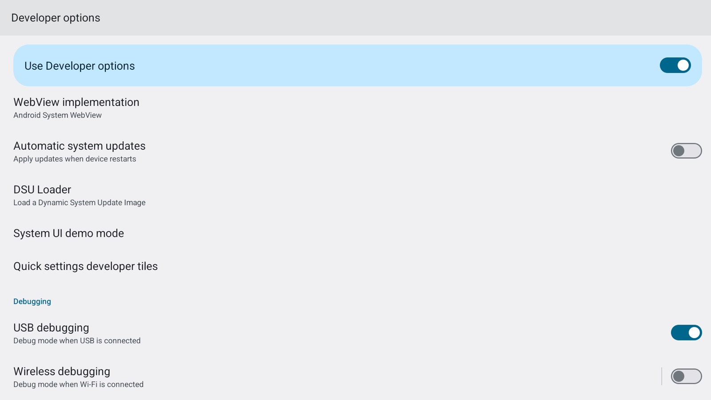
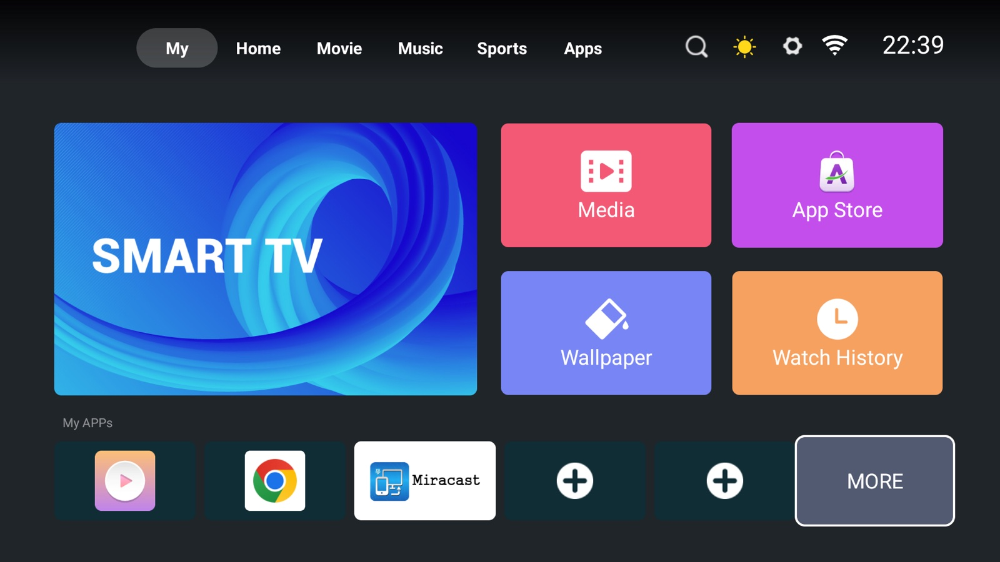
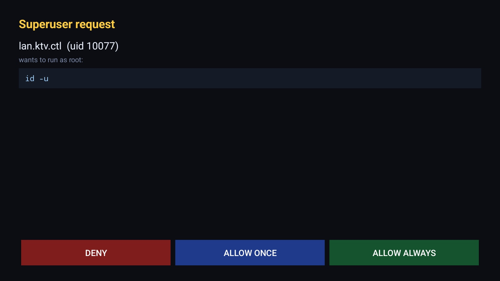
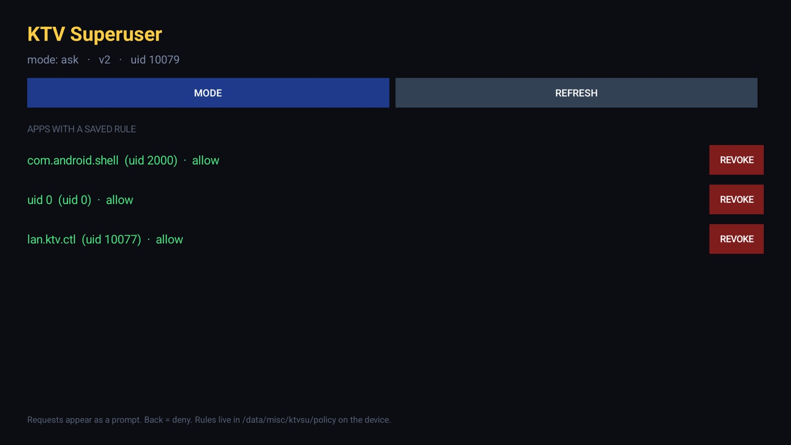

# Rooting a no-name HiSilicon Hi3751V560 Android TV

Everything in this repository came from one cheap, unbranded "AndroidTV" box bought
in Brazil, running a vendor build nobody documents. No exploit was used. No bootloader
unlock, no soldering, no firmware flashing. The box was already wide open and nobody
had written down how.

This is that write-up: what the device is, how it was probed, how ADB was unlocked,
how full root was obtained, and how app-level `su` was added on a build where setuid
binaries are neutered by the Android app sandbox.

> **Status:** root achieved and **reboot-validated**. `su` works from inside a normal
> untrusted app sandbox. The box survived a full power cycle with the root daemon
> autostarting from `/system/etc/init`.

---

## TL;DR

If you have the same box (check [docs/01-device-profile.md](docs/01-device-profile.md)
first), this is the whole path:

```bash
# 1. Enable developer mode on the TV, then turn on "USB debugging".
#    Settings -> About phone -> tap "Build number" 7 times
#    Settings -> System -> Developer options -> USB debugging = ON

# 2. Connect. There is NO RSA authentication on this build.
adb connect <tv-ip>:5555
adb shell id              # uid=2000(shell)

# 3. Root. This is accepted on this build.
adb root
adb shell id              # uid=0(root) context=u:r:su:s0

# 4. Make it permanent (optional but recommended): a root daemon + su client,
#    because plain setuid binaries do NOT work from the app sandbox.
./scripts/install-su.sh <tv-ip>

# 5. Optional: put an approval prompt in front of root, and strip the vendor adware.
./scripts/install-superuser.sh <tv-ip>
./scripts/debloat.sh <tv-ip>
```

Total time: about ten minutes. Zero risk of bricking — nothing is written to a boot
partition, and ADB over TCP survives reboots independently of everything here.

---

## Proof

The box, before anything was touched — vendor `System Info`, the only screen it shows you:



Developer options, reached only by launching an activity (the vendor settings app never
shows them). **USB debugging ON**, and wireless debugging present but unavailable:



```
$ adb root
restarting adbd as root
$ adb shell id
uid=0(root) ... context=u:r:su:s0

$ adb shell su -c 'id -u'          # from an unprivileged shell
0
```

Launcher after debloating and a full power cycle — intact, 284 MB of RAM reclaimed:



And the superuser gate, so root is a decision rather than a default:




Full transcripts, including the reboot validation and the setuid failure, are in
[docs/08-evidence.md](docs/08-evidence.md).

---

## Why this works (the short version)

Three vendor mistakes, stacked:

1. **`persist.adb.tcp.port=5555` is baked into `init.bigfish.rc`.** ADB over TCP is
   configured before you ever touch the TV. The only gate is the framework setting
   `adb_enabled`, which the "USB debugging" toggle flips.

2. **`ro.adb.secure` is unset.** There is no RSA key authorization. `/data/misc/adb/adb_keys`
   does not exist even after connecting. Any host on the LAN can talk to adbd — no pairing
   dialog, no fingerprint to accept. This is the single worst thing about the build.

3. **SELinux is `Permissive`.** `getenforce` returns `Permissive`. Denials are logged, never
   enforced. Combined with the previous two, `adb root` escalates adbd to uid 0 and restarts
   it with `--root_seclabel=u:r:su:s0`, which a normal Android build would refuse on a
   non-debuggable device.

Past that, `/` is a plain ext4 mounted read-only by default, with **no dm-verity and no
bootloader lock**. `mount -o rw,remount /` as root works, so `/system` is writable. That is
what makes persistent changes possible without touching a single boot partition.

---

## What is in this repo

| Path | What it covers |
| --- | --- |
| [docs/01-device-profile.md](docs/01-device-profile.md) | Exact hardware, build fingerprint, partition table, how to identify the same box |
| [docs/02-recon.md](docs/02-recon.md) | How the device was profiled from the LAN, and the port 4321 mystery |
| [docs/03-enable-adb.md](docs/03-enable-adb.md) | Getting developer mode + USB debugging on, with every menu that does and does not work |
| [docs/04-root.md](docs/04-root.md) | `adb root`, why it succeeds, and how to make `/system` writable |
| [docs/05-app-level-root.md](docs/05-app-level-root.md) | Why setuid fails, and the daemon + client design that replaces it |
| [docs/06-debloat.md](docs/06-debloat.md) | The preinstalled adware, what is safe to disable, and how to undo it |
| [docs/07-troubleshooting.md](docs/07-troubleshooting.md) | Every failure encountered, including the flaky-`su` red herring |
| [docs/08-evidence.md](docs/08-evidence.md) | Verbatim command transcripts and screenshots backing every claim |
| [docs/09-superuser.md](docs/09-superuser.md) | v2: on-screen approval before an app gets root, plus a rules manager |
| [src/su/](src/su) | `su` client, `ktvsud` root daemon, init `.rc`, Makefile |
| [src/manager/](src/manager) | the KTV Superuser app (approval prompt + rules manager) |
| [scripts/](scripts) | `check.sh`, `root.sh`, `install-su.sh`, `uninstall-su.sh`, `debloat.sh`, `recon.sh` |

---

## Read this before you start

**This is not a "one-click root".** It is a documented, reproducible procedure for a
specific class of device that shipped misconfigured. It depends on:

- `ro.adb.secure` being unset. If your box has `ro.adb.secure=1`, you will get the normal
  RSA prompt and will need physical access to tap "Allow".
- `adb root` being accepted. If your build refuses it, the `/system` route below needs a
  different escalation (see [docs/04-root.md](docs/04-root.md#if-adb-root-is-refused)).
- SELinux running permissive. If it is enforcing, the `su` daemon and the `.rc` file need
  policy work this repo does not cover.

**Ways to brick it:** writing a bad image to `boot`, `recovery`, `fastboot`, `bootargs`,
`dtbo` or `slaveboot`. This repo never touches any of them. Everything here writes to
`/system` and `/data` only.

**Ways to lose root:** a vendor OTA that replaces `/system`. The debloat script disables
the OTA updater (`com.cultraview.osupdate`) specifically to prevent that — re-enable it
if you actually want vendor updates, and expect to lose everything documented here.

**Security warning, stated plainly:** with ADB on `0.0.0.0:5555` and no authentication,
*anyone on your Wi-Fi can root this TV in three commands.* If the TV is on a shared
network, run `adb shell setprop service.adb.tcp.port -1` when you are done, or firewall
port 5555. Root access being convenient and root access being available to your guests
are the same property.

---

## Reproducibility

Every command in these docs was executed against a live device and the output pasted
back. Where something was inferred rather than observed, it says so.

Tested build, once more, because it is the thing that matters:

```
ro.build.fingerprint  HiDPT/Hi3751V560_DMOH/Hi3751V560:14/UP1A.231105.003.A1/eng.yankeq.20241230.160120:userdebug/dev-keys
ro.build.type         userdebug
ro.product.model      AndroidTV
ro.board.platform     bigfish
ro.hardware           bigfish
ro.product.cpu.abilist armeabi-v7a,armeabi
ro.zygote             zygote32
ro.build.version.security_patch  2023-11-01
```

If your `ro.build.fingerprint` differs, the *method* probably still applies but the
package names and vendor quirks in [docs/06-debloat.md](docs/06-debloat.md) almost
certainly do not.

---

## License

MIT. See [LICENSE](LICENSE). Do whatever you want; no warranty, and if you turn your
television into a brick it was your television.
