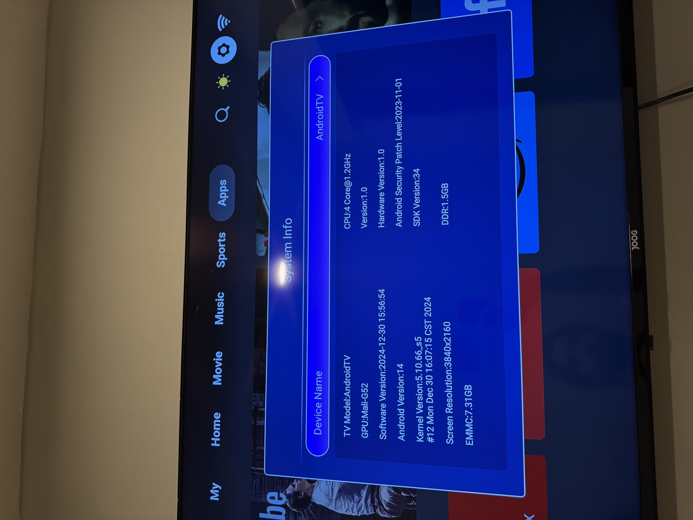
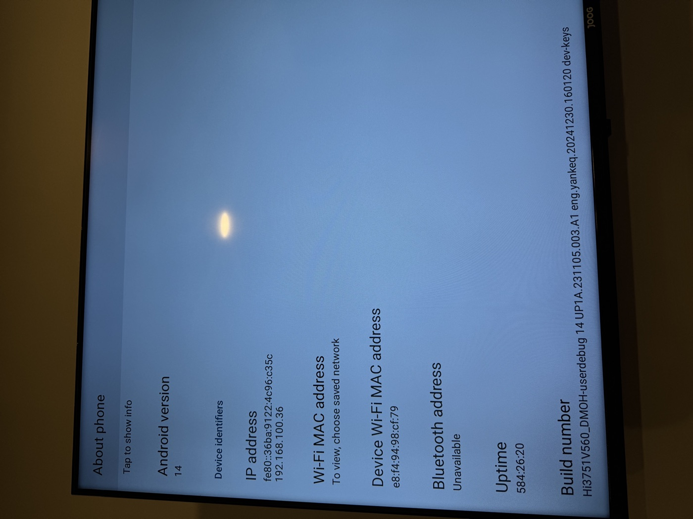

# 01 — Device profile

Everything here was read off the device, not off a spec sheet. Spec sheets lie about
these boxes; the vendor's own `getprop` output does not.



*The vendor's own System Info screen. This is the only device information the TV exposes
through its UI, and its labels are not clickable — see [03-enable-adb.md](03-enable-adb.md).*

## Hardware

| Field | Value | Source |
| --- | --- | --- |
| SoC | HiSilicon **Hi3751V560** | `ro.product.device` |
| Platform codenames | `bigfish`, `hi3751` | `ro.board.platform`, `/proc/cpuinfo` |
| CPU | 4× ARMv7 (Cortex-A55 class) @ 1.2 GHz | vendor UI, `/proc/cpuinfo` |
| CPU architecture | **32-bit only** — `armeabi-v7a,armeabi`, `zygote32` | `ro.product.cpu.abilist` |
| GPU | Mali-G52 (kbase driver loaded) | vendor UI, `kbase_job_fault` kernel thread |
| RAM | **1.5 GB** (1469 MB usable) | `free -m` |
| Storage | eMMC, 7.31 GB nominal | vendor UI |
| Panel | 1920×1080 @ 240 dpi | `wm size`, `wm density` |
| Network | Wi-Fi 802.11 only (no Ethernet port used) | DHCP lease type |
| Model string | `AndroidTV` (i.e. nothing useful) | `ro.product.model` |

The generic `AndroidTV` model name is why this box is effectively anonymous: no vendor
string, no part number, no product page. The only reliable identifier is the SoC.



*AOSP `About phone`, a different settings app from the one above. The build line at the
bottom is the identifier that actually matters.*

## Software

```
ro.build.fingerprint  HiDPT/Hi3751V560_DMOH/Hi3751V560:14/UP1A.231105.003.A1/eng.yankeq.20241230.160120:userdebug/dev-keys
ro.build.description  Hi3751V560_DMOH-userdebug 14 UP1A.231105.003.A1 eng.yankeq.20241230.160120 dev-keys
ro.build.flavor       Hi3751V560_DMOH-userdebug
ro.build.type         userdebug
ro.build.version.sdk  34                       (Android 14)
ro.build.version.security_patch  2023-11-01
ro.zygote             zygote32
ro.hardware           bigfish
ro.product.device     Hi3751V560
```

Two details worth staring at:

- **`userdebug` + `dev-keys`** — an engineering build shipped to consumers, signed with the
  vendor's own dev keys rather than release keys.
- **`ro.build.version.security_patch = 2023-11-01`** on a kernel built 2024-12-30. The
  vendor updated the kernel without shipping any Android security patches since November
  2023.

The ODM fingerprints for `odm`, `product`, `system`, `system_ext`, `vendor` and
`vendor_dlkm` all point at **`Hi3751V553`** while the product is `Hi3751V560`. The
firmware is a shared image family across at least two panel/board variants — relevant if
you ever go looking for firmware downloads.

## Kernel

```
Linux version 5.10.66_s5 (nobody@android-build)
  arm-hi100-linux-gcc (gcc-linaro-7.4-2019.02 glibc-2.30 czyong Thu Jan  9 19:34:00 CST 2020) 7.4.1
  #12 SMP PREEMPT Mon Dec 30 16:07:15 CST 2024
```

`arm-hi100-linux-gcc` is HiSilicon's own cross toolchain. `_s5` suffix, SMP PREEMPT,
built by user `nobody` on a build host.

## Key security properties

| Property | Value | Meaning |
| --- | --- | --- |
| `getenforce` | **Permissive** | SELinux logs denials, never enforces them |
| `ro.secure` | 1 | adbd drops privileges on start |
| `ro.debuggable` | **0** | normally blocks `adb root` on a userdebug build |
| `ro.adb.secure` | **(unset)** | **no ADB key authentication whatsoever** |
| `persist.adb.tcp.port` | 5555 | TCP ADB configured by init at boot |
| `service.adb.tcp.port` | 5555 | set alongside the above |
| dm-verity | absent | `/system` is not integrity-checked |
| bootloader lock | not enforced for our purposes | `adb remount` complains, manual remount works |

`ro.adb.secure` being an empty string is the important one. On a normal Android device,
`ro.adb.secure=1` makes adbd refuse any host key it has not seen before, and the TV shows
an "Allow USB debugging?" dialog. Here, `/data/misc/adb/adb_keys` does not exist *even
after* a successful connection, which proves the authorization step never ran.

## Storage layout

Root filesystem device names, read from `/dev/block/by-name/`:

```
fastboot  bootargs  bootargsbak  slaveboot  recovery  panelparam  deviceinfo
logo      boot      dtbo         atf         securestore  misc      bootmusic
bootmusicsec  demura  tconparam  trustedcore  versioninfo  system  vendor  atv
log       tconparam cache        reserved    userdata
```

Mounted filesystems at runtime (default, before any remount):

```
/dev/block/mmcblk0p20 on /       type ext4 (ro,seclabel,nodev,relatime)
/dev/block/mmcblk0p21 on /vendor type ext4 (ro,seclabel,relatime,inode_readahead_blks=8)
/dev/block/mmcblk0p26 on /data   type ext4 (rw,seclabel,nosuid,nodev,noatime,journal_checksum,...)
/dev/block/mmcblk0p24 on /cache  type ext4 (rw,seclabel,nosuid,nodev,noatime,data=ordered)
```

Two consequences:

- `/` carries **`/system`** — it is not a separate partition. One `mount -o rw,remount /`
  gives you a writable `/system`.
- `/data` is mounted **`nosuid`**. Setuid binaries placed in `/data` will not work. `/system`
  is *not* mounted `nosuid`, but the app sandbox still neuters setuid — see
  [05-app-level-root.md](05-app-level-root.md).

**Do not flash anything to `boot`, `slaveboot`, `bootargs`, `dtbo` or `fastboot` unless you
have a verified image for your exact panel variant.** There is no published recovery image
for this box, and `Hi3751V553` firmware will likely enumerate the panel wrong.

## Capacity

```
/ partition (mmcblk0p20)  1.8 G total, ~185 M free   <- /system lives here, be careful
/data (mmcblk0p26)        4.5 G total, ~2.6 G free
```

185 MB of free space on `/` is the real constraint. The `su` daemon and client together
cost 16 KB, so this is fine, but do not go copying big payloads into `/system`.

## Identifying the same box

Run `adb shell getprop` once you can connect, and check in this order:

1. `ro.product.device` = `Hi3751V560`
2. `ro.board.platform` = `bigfish`
3. `ro.build.fingerprint` contains `HiDPT/Hi3751V560_DMOH`
4. `ro.build.type` = `userdebug`, tag `dev-keys`
5. `getenforce` = `Permissive`
6. `getprop ro.adb.secure` is empty

Matching 1–4 means the method applies. Matching 5–6 means it is this easy. If your
`ro.adb.secure` is `1`, expect the normal RSA dialog and physical access requirement,
but everything from [04-root.md](04-root.md) onward may still work once you are authorized.
