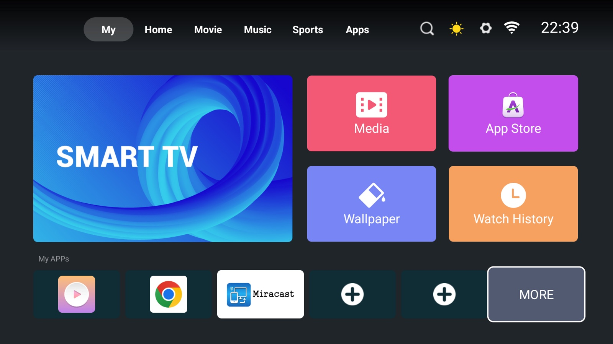

# 06 — Debloat

The reference device shipped with a persistent ad-injection framework installed months
after the firmware, plus the usual vendor inventory. This is what was removed, why, and
how to put it back.

Nothing here is required for root. It is the "make the TV stop watching you and give me my
RAM back" chapter.

## Baseline

Before, on a 1.5 GB box:

```
Mem:   1469 total   1335 used   133 free
```

That is 92% memory pressure at idle. After removing the list below and rebooting:

```
Mem:   1469 total   1051 used   417 free
```

**+284 MB** at idle, from disabling seven packages.

## The list

| Package | What it is | Verdict |
| --- | --- | --- |
| `com.sraf.launcher.ext` | "SadApp" — persistent system app, `FloatVideoWindowService`, logs every foreground activity. Installed 2026-05-04, five months after the firmware. Adware. | **remove** |
| `com.zeasn.deviceportal.asdprovider.cetus.pub` | device-portal advertising provider | **remove** |
| `com.tencent.qqlivei18n` | WETV, preinstalled streaming junk | remove if unwanted |
| `com.ctv.hotelsetting` | hotel / kiosk mode | remove unless it is literally a hotel |
| `com.ctv.autotest.helper` | broadcasts `android.intent.action.AUTO_TEST_CMD` at the factory-test harness | remove |
| `com.cultraview.cusfactorytest` | factory test harness | remove |
| `com.cultraview.osupdate` | OTA updater — A/B `UpdateEngine` wrapper | **freeze** (see below) |

### Why freeze the OTA updater

Your root depends on two things staying true: SELinux staying permissive, and `/system`
content staying as you left it. A vendor OTA can change both, and will wipe `/system/bin/su`,
`/system/bin/ktvsud` and `/system/etc/init/ktvsu.rc`.

`com.cultraview.osupdate` is the entry point the vendor uses to push firmware. Disabling it
is the difference between "rooted TV" and "TV that was rooted until Thursday".

If you want vendor updates, re-enable it and accept that you will need to redo
[05-app-level-root.md](05-app-level-root.md) afterwards.

### What was deliberately kept

```
com.zeasn.launcher            the actual launcher -- do not touch unless replacing it
com.cultraview.tvboot         boot helper
com.cultraview.setting        the blue TV settings UI
com.hisilicon.miracast        casting
com.cultraview.filemanager    file manager (useful)
com.android.settings          AOSP Settings -- this is how you reach Developer options
com.android.traceur           on-device tracing, genuinely useful when debugging
com.yandex.browser.tv         a real browser
nextapp.fx                    FX File Explorer
com.apkinstaller.ApkInstaller APK installer
```

Netflix, YouTube, Disney+, Prime Video and similar are preinstalled and harmless. Drop them
if you do not use them; they cost RAM only when running.

## Run it

```bash
./scripts/debloat.sh <tv-ip>          # disable
./scripts/debloat.sh <tv-ip> --undo   # re-enable everything
```

The script uses `pm disable-user --user 0` rather than deleting anything. Disabling a system
app keeps the APK on the read-only system partition and only marks it disabled for user 0,
which is why `--undo` is a clean `pm enable`.

Manual equivalent:

```bash
adb shell pm disable-user --user 0 com.sraf.launcher.ext
# Package com.sraf.launcher.ext new state: disabled-user

adb shell pm list packages -d | sed 's/package://'
# com.sraf.launcher.ext
# ...
```

## Things to know

**Disabling does not free RAM until the process dies.** A `PERSISTENT` system app keeps
running until reboot. The 284 MB only materialised after a power cycle.

**The vendor framework may raise an ad-consent screen after the first reboot.** On the
reference device, booting with the ad provider disabled produced an "Advertising Choose"
dialog with a live Advertise ID:

```
Advertising Choose
Advertise ID: <your-device-uuid>      (a real per-device identifier; redacted here)
[Reset AD ID]  [Manage Options]            [Not Agree] [Agree]
```


Pressing **Not Agree** dismisses it permanently and declines personalised tracking. It is
not damage and it is not a boot loop — the launcher was already resumed underneath
(`dumpsys` showed `mCurrentFocus=com.zeasn.launcher`), the dialog is just drawn on top.

**Do not disable the launcher** unless you have a replacement installed and verified first.
With no launcher the TV boots to a black screen and you will be doing everything through
`adb shell am start`.

## Verifying nothing broke

```bash
adb shell dumpsys activity activities | grep -E 'ResumedActivity' | head -2
# ResumedActivity: ActivityRecord{... com.zeasn.launcher/.ui.MainActivity}

adb shell free -m | sed -n 2p
adb shell pm list packages -d | wc -l
```

If the home screen is gone: `adb shell pm enable com.zeasn.launcher`.



## Launcher after debloat

The vendor launcher (its Apps tab) still works after the purge — the box is not missing
anything it needs:

Screen size is 1920×1080 with density 240. `screencap` works but occasionally returns a
stale frame until something forces a redraw — if you get an identical image twice, send
`input keyevent KEYCODE_DPAD_DOWN` and capture again.

```bash
adb exec-out screencap -p > tv.png
```
