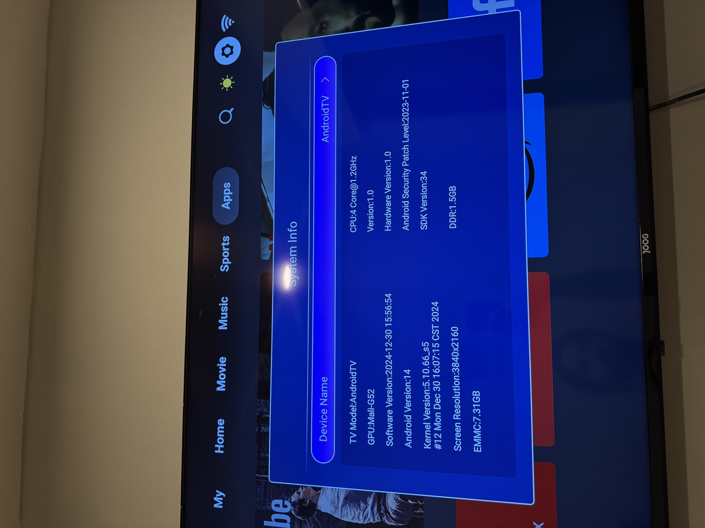
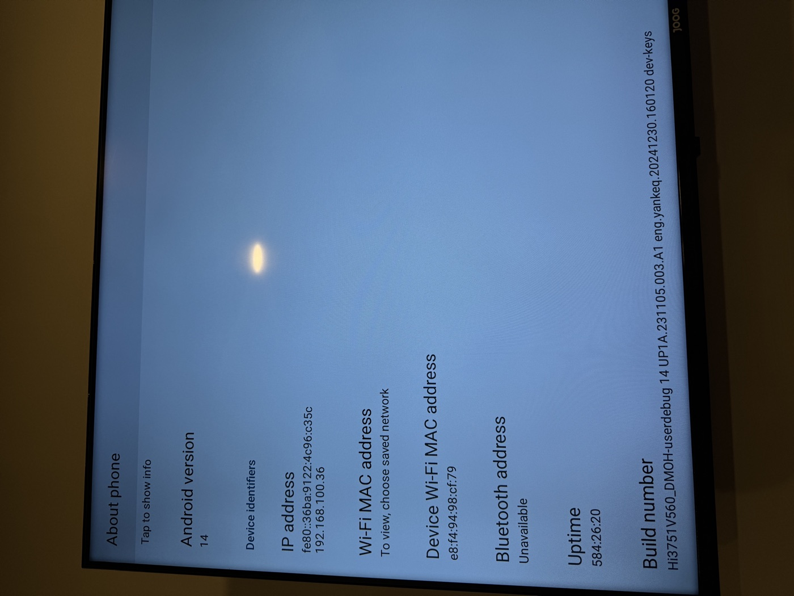
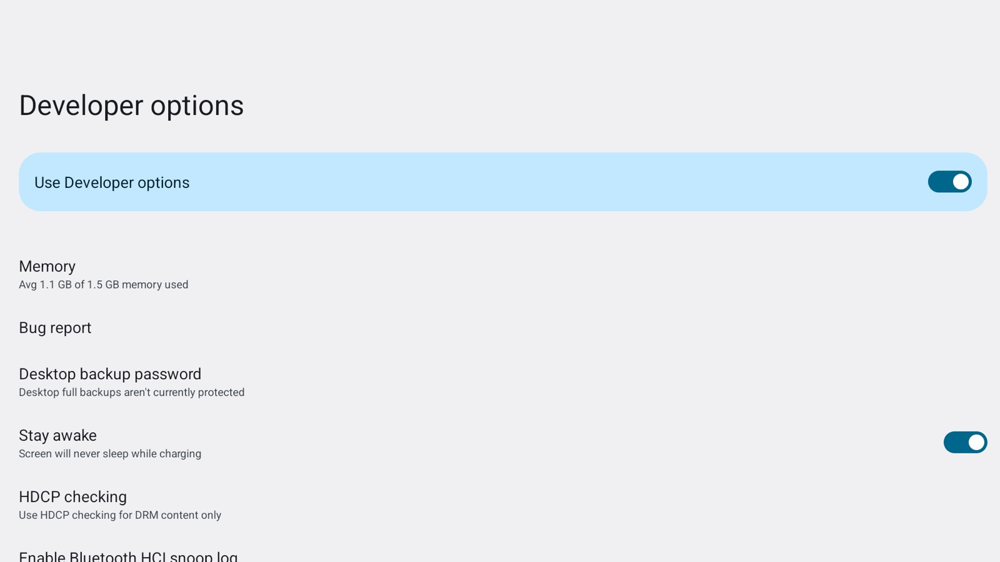
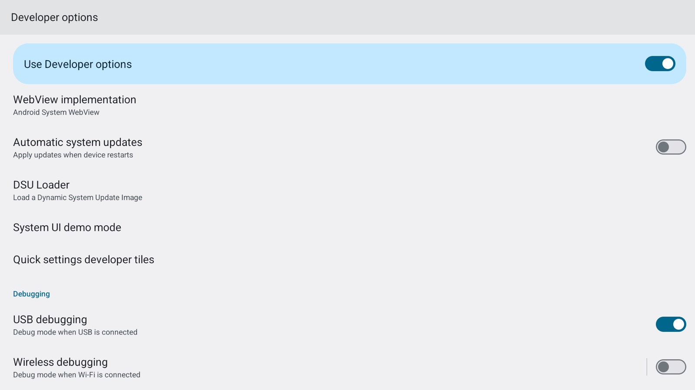

# 08 — Evidence

Every claim in this repository came from a command run against the reference unit. This
page collects the raw transcripts in one place so a reader can judge whether the method
is real before touching their own TV.

Outputs are verbatim, pasted from the session. Where a line was trimmed for width it says
so. Nothing here is reconstructed from memory.

---

## 1. The device says it is what we say it is

Vendor `System Info` screen, before any modification:



AOSP `About phone`, reachable only after launching `com.android.settings` by intent:



Note the build line at the bottom:

```
Hi3751V560_DMOH-userdebug 14 UP1A.231105.003.A1 eng.yankeq.20241230.160120 dev-keys
```

`userdebug` and `dev-keys` on a consumer product, and a security patch level of
`1 November 2023` on a kernel built `30 December 2024`.

## 2. Developer options and USB debugging

`./scripts/check.sh` against the live device:

```
-----------------------------------------------------------------
build.fingerprint          HiDPT/Hi3751V560_DMOH/Hi3751V560:14/UP1A.231105.003.A1/eng.yankeq.20241230.160120:userdebug/dev-keys
product.device             Hi3751V560
board.platform             bigfish
build.type                 userdebug
ro.secure                  1
ro.debuggable              0
ro.adb.secure              (unset)
persist.adb.tcp.port       5555
abilist                    armeabi-v7a,armeabi
getenforce                 Permissive
-----------------------------------------------------------------
[ok]   device matches the reference Hi3751V560
[ok]   ro.adb.secure is unset -> ADB has NO key authentication
[ok]   SELinux is Permissive
[ok]   32-bit ARM present (binaries here target armeabi-v7a)
```

Developer options, as reached through the
`android.settings.APPLICATION_DEVELOPMENT_SETTINGS` action:



Scrolled to the Debugging section. **USB debugging ON, Wireless debugging greyed out and
unavailable:**



The activity that is running is:

```
ResumedActivity: ActivityRecord{... com.android.settings/.Settings$DevelopmentSettingsDashboardActivity t452}
```

This is why the action works and an explicit
`com.android.settings/.Settings$DevelopmentSettingsDashboardActivity` intent does not: the
activity is not exported, but the action resolves internally.

## 3. ADB escalation

```
$ adb root
restarting adbd as root

$ adb shell id
uid=0(root) gid=0(root) groups=0(root),1004(input),1007(log),1011(adb),1015(sdcard_rw),
    1028(sdcard_r),1078(ext_data_rw),1079(ext_obb_rw),3001(net_bt_admin),3002(net_bt),
    3003(inet),3006(net_bw_stats),3009(readproc),3011(uhid),3012(readtracefs)
    context=u:r:su:s0
```

`./scripts/root.sh`:

```
[*] shell uid: 2000
[*] adb root
    adbd is already running as root
[*] uid now: 0  context=u:r:su:s0
[*] testing /system writability
[ok] /system is writable
```

And the thing that was open all along:

```
$ adb shell getprop ro.adb.secure
                                        <- empty
$ adb shell ls -l /data/misc/adb/
total 8
                                        <- no adb_keys file, ever
```

## 4. Port 4321, identified

```
$ adb shell su -c 'ss -tnlp'
State   Recv-Q Send-Q Local Address:Port   Peer Address:Port   users:(...)
LISTEN  0      20     0.0.0.0:4321           0.0.0.0:*           users:(("hwtvmw@1.0-serv",pid=1707,fd=20))
LISTEN  0      4      *:5555                 *:*                 users:(("adbd",pid=10433,fd=12))
```

`vendor.hisilicon.hardware.hwtvmw@1.0-service`. TV middleware HAL. Not ADB, not a debug
port. Before root was available this was unidentifiable — `/proc/<pid>/fd` is `0500` and
owned by the process, so even a `shell` UID cannot map an inode to a process.

## 5. App-level `su`, and why setuid failed

The setuid attempt, from inside an app sandbox:

```
$ /system/bin/su -c 'id -u'
su: permission denied: Operation not permitted
```

Not a missing file, not SELinux — the binary ran and `setuid(0)` returned `EPERM`. The
sandbox sets `no_new_privs`, so the setuid bit is discarded at exec time.

`./scripts/install-su.sh`:

```
[*] device ok: Hi3751V560 / Permissive
[*] building for armv7a-linux-androideabi21
[*] root uid 0
[*] pushing
[*] installing to /system/bin
[*] writing /system/etc/init/ktvsu.rc
[*] starting daemon now (no reboot needed)
[*] restarting daemon
[*] ktvsud processes: 1
[*] unprivileged uid 2000 -> su -c 'id -u' = 0
[ok] su works from an unprivileged context.
```

Note the script deliberately runs `adb unroot` before verifying, so the check cannot pass
by accident on a root adbd.

From *inside an application sandbox* (this is the case setuid cannot satisfy):

```
id -u                -> 10077
su -c 'id -u'        -> 0
su -c 'id'           -> uid=0(root) ... context=u:r:su:s0
```

## 6. Reboot validation

The point of the `.rc` file is surviving a power cycle. Full reboot, then:

```
boot completed after ~38 s

$ adb shell id
uid=2000(shell) ...                       <- adbd back as shell, automatically
$ adb shell getprop init.svc.ktvsu
running
$ adb shell ps -A -o USER,PID,NAME | grep ktvsud
root          1891 ktvsud
$ adb shell su -c 'id -u'
0
```

Nothing was started by hand after the reboot. init started the daemon from
`/system/etc/init/ktvsu.rc`, and `su` worked from an unprivileged context immediately.

## 7. Debloat, measured

Before:

```
Mem:  1469 total  1335 used  133 free
```

After disabling seven packages **and** power-cycling (a `PERSISTENT` app keeps its memory
until it dies):

```
Mem:  1469 total  1051 used  417 free
```

```
$ adb shell pm list packages -d
package:com.sraf.launcher.ext
package:com.cultraview.cusfactorytest
package:com.ctv.autotest.helper
package:com.cultraview.osupdate
package:com.tencent.qqlivei18n
package:com.zeasn.deviceportal.asdprovider.cetus.pub
package:com.ctv.hotelsetting
```

The first reboot after debloating raises this, once:


**Not Agree** dismisses it permanently. The launcher was already resumed underneath — see
`dumpsys` in [07-troubleshooting.md](07-troubleshooting.md).

## 8. The TV still works

Vendor launcher after debloating and rebooting — Apps tab, intact, RAM reclaimed:


```
$ adb shell dumpsys activity activities | grep ResumedActivity
ResumedActivity: ActivityRecord{... com.zeasn.launcher/.ui.MainActivity t3}
```

---

## What is *not* proven here

Being explicit about the limits of the evidence:

- **Why `adb root` is accepted** is inference. The observed facts are `ro.secure=1`,
  `ro.debuggable=0`, permissive SELinux, and an adbd running with
  `--root_seclabel=u:r:su:s0`. The stock refusal path is absent from this adbd. The vendor
  most likely built it without the usual gates; that has not been confirmed from source.
- **Whether a reboot without `adb root` keeps app-level `su`** is confirmed, but a reboot
  *with an OTA applied* is not — no OTA was ever installed, deliberately.
- **Whether this works on the `Hi3751V553` variant** of this firmware family is untested.
  Only one unit of one variant was examined.
- **Screen captures** are from `screencap`. This hardware occasionally returns a stale
  frame; if a capture matters, force a redraw first
  ([07-troubleshooting.md](07-troubleshooting.md#screencap-returns-the-same-image-twice)).
