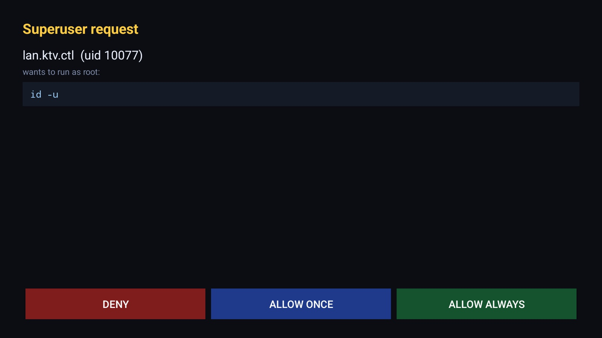
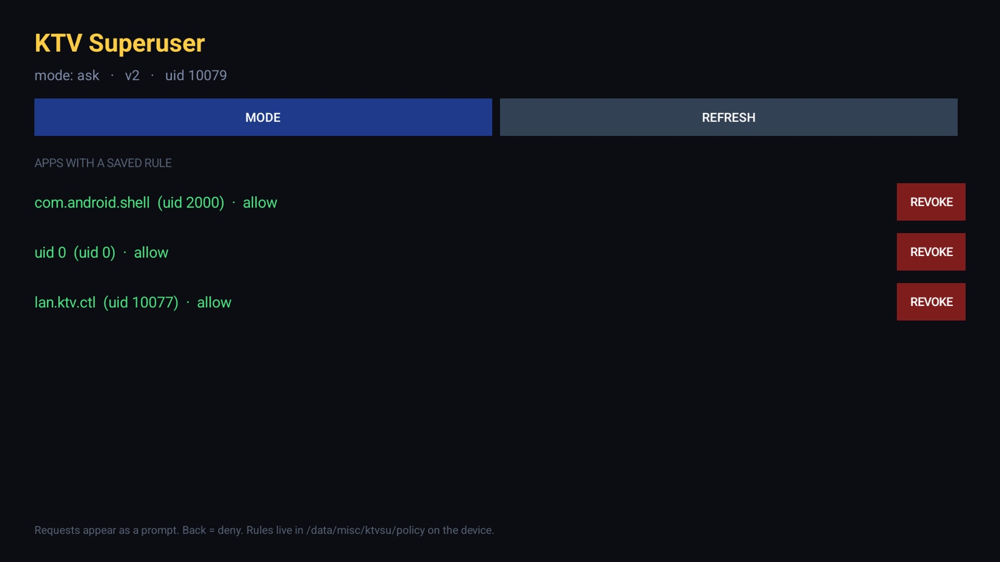

# 09 — Superuser: approving apps before they get root

The daemon in [05-app-level-root.md](05-app-level-root.md) hands root to any process that
asks. That is how a classic `su` behaves, and it is fine on a device with one owner and no
hostile apps — but it is a blunt instrument once you start installing things.

This is v2: the same daemon, one tap in front of it.





## What changed

| | v1 | v2 |
| --- | --- | --- |
| Who gets root | anyone who connects | policy per app uid |
| Unknown app | root | **on-screen prompt** |
| Remembering | n/a | `ALLOW ALWAYS` writes a rule |
| Revoking | n/a | list in the app, one button |
| Global switch | n/a | `ask` / `allow-all` / `deny-all` |

The client (`su`) and its wire protocol are **unchanged**, so anything already calling
`su -c` keeps working. All the new behaviour is inside `ktvsud` plus a small Android app.

## Architecture

Two abstract unix sockets, both served by the same root daemon:

```
"ktvsu"      clients (su). Peer uid read with SO_PEERCRED.
"ktvsuadm"   the Superuser app. Peer uid must equal admin_uid, else refused.
```

That second check is the whole access control story: the app is identified by its **kernel
uid**, which cannot be spoofed, and `admin_uid` is a root-owned file the app cannot write.
No tokens, no shared secrets, nothing to leak.

State lives in `/data/misc/ktvsu` (0700, root):

```
policy      <uid> allow|deny   one per line
mode        ask | allow-all | deny-all
admin_uid   the one uid allowed on the admin socket
pending/    in-flight requests, one file each
answer/     decisions written by the daemon
```

### Request lifecycle

```
app calls su -c "id"
   └─ su connects to "ktvsu", sends the command
        └─ ktvsud reads SO_PEERCRED -> 10077
             ├─ policy says allow  -> run, stream output, done
             ├─ policy says deny   -> "su: denied by policy", exit 77
             └─ no rule, mode=ask:
                  write pending/<id>  (uid, package, command)
                  the app polls "ktvsuadm" every ~700 ms
                  the app raises PromptActivity over whatever is on screen
                  user taps -> app sends answer -> daemon writes answer/<id>
                  daemon resumes the waiting su, or denies after 120 s
```

The waiting `su` is a blocked `read()` on its own socket. Nothing polls in the client.

### The bug that cost the most time

The daemon bound its sockets with `bind(s, &sa, sizeof(sa))`. That records the abstract
name **with all 106 bytes of `sun_path`**, trailing NULs included:

```
@ktvsuadm@@@@@@@@@@@@@@@@@@@@@@@@@@@@@@@@@@...     <- wrong
```

Our own C client did the same thing, so `su` worked perfectly and hid the problem. Then
`android.net.LocalSocket` — which connects with the *correct* length,
`offsetof(sun_path) + 1 + strlen(name)` — got `ECONNREFUSED`, and the app reported
"daemon unreachable".

Fix, in both places:

```c
socklen_t len = offsetof(struct sockaddr_un, sun_path) + 1 + strlen(name);
bind(s, (struct sockaddr *)&sa, len);
```

If you are writing anything that listens on abstract sockets for Android to talk to, this
is the one detail that will bite you.

## Install

```bash
./scripts/install-superuser.sh <tv-ip>
```

It builds both binaries and the APK, installs them, seeds the policy so `adb shell` never
prompts, grants `SYSTEM_ALERT_WINDOW` (needed to raise the prompt over another app on
Android 10+), and starts the manager.

Seeding `2000 allow` matters: without it, every `adb shell su -c ...` from your laptop would
need a tap on a TV you are not looking at.

## Using it

On the TV, **KTV Superuser** lists every saved rule with its package name, uid and policy,
plus a `REVOKE` button each. `MODE` cycles:

- `ask` — unknown apps prompt. This is the default and the useful one.
- `allow-all` — v1 behaviour, no prompts.
- `deny-all` — nothing gets root except explicit `allow` rules.

On a prompt:

| Button | Effect |
| --- | --- |
| DENY | this request only, nothing remembered |
| ALLOW ONCE | this request only, nothing remembered |
| ALLOW ALWAYS | this request, plus a persistent `allow` rule |
| BACK | deny |

Focus starts on **DENY**, so a stray ENTER press on a remote never grants root.

## Commands that do not prompt

`uid 0` and `uid 2000` (`shell`) are seeded at install time. `su` from an `adb shell` is
therefore instant — which keeps [install-su.sh](../scripts/install-su.sh) and every one of
these docs working.

## Locking yourself out

If the manager app is uninstalled or its uid changes (reinstall), the admin socket rejects
everything, requests time out, and apps silently lose root. `adb root` is unaffected.

Recovery:

```bash
adb root
adb shell "cat /data/misc/ktvsu/policy"        # see what is allowed
adb shell "echo allow-all > /data/misc/ktvsu/mode"   # temporary: no prompts
adb shell "pm list packages -U | grep ktvsu"   # new uid
adb shell "echo <new-uid> > /data/misc/ktvsu/admin_uid"
adb shell "echo ask > /data/misc/ktvsu/mode"
```

To remove it entirely and go back to v1-style unfettered `su`:

```bash
adb root
adb shell rm -rf /data/misc/ktvsu
adb uninstall lan.ktvsu.manager
```

The daemon then behaves like v1: `mode` missing reads as `ask`, but with no admin socket
client nothing can answer, so everything unknown is denied — which is the safe failure
direction, and why `allow-all` is the escape hatch.

## Threat model, honestly

**What this stops:** an app you sideloaded from a store, or a vendor app you did not
debloat, quietly obtaining root behind your back. It gets a prompt you can see and deny.

**What this does not stop:**

- An app that spams requests until you are annoyed into tapping ALLOW. There is no rate
  limit; the 120 s timeout is per request.
- Anything that can already write to `/data/misc/ktvsu` (only root) or run as the manager's
  uid.
- A denial-of-service: a request left unanswered holds a blocked `su` for two minutes and a
  pending file. Trivial to abuse, and it only annoys you.

**What it is not:** a security boundary against a compromised OS. `adb root` still gives
anyone on your Wi-Fi total control, prompt or no prompt. If you care about that, close
port 5555 — the superuser app is not a substitute.
